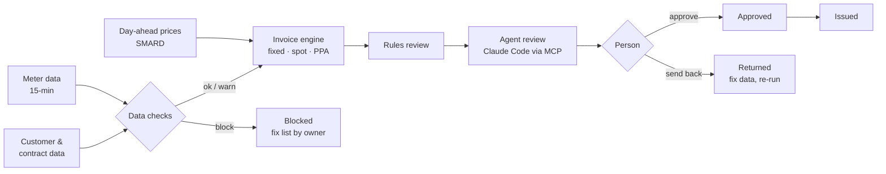

# trawa-billing-agent

A monthly electricity billing run for business customers, built the way I would want a Finance
team to trust it: **code checks the data and calculates every euro, an agent reviews and explains,
and a person approves.**

It bills 15 fictional German SMEs on fixed, spot-indexed and PPA contracts from 15-minute meter
data and real quarter-hour day-ahead prices (SMARD, DE-LU, September 2026). Seven records carry
deliberate data problems, and the run has to catch every one of them before anything is invoiced.

I built it as an application project for trawa's Finance Process & Systems team. The posting's
first priority is redesigning Quote-to-Cash for energy data (15-minute time series, PPAs, spot
prices) with AI agents and workflow automation that behave like infrastructure, not demos. This is
a small, working slice of that, scoped to what I could build and test end to end.

## The process



| Step | Who | What they can do |
|---|---|---|
| Data checks | code | Block or warn. Blocked invoices cannot be approved by anyone. |
| Invoice engine | code | Calculate every amount. Nothing else calculates. |
| Rules review | code | Flag for review, write the customer explanation. |
| Agent review | Claude (MCP tools) | Read everything; flag for review with reasons; write the customer explanation. Cannot approve, unflag or change amounts. |
| Approve, return, issue | a person | Only people. Approving a flagged invoice needs a note. |

Every calculation, review and status change goes into `audit_log` with the actor and time.

## Quick start

```bash
python3 -m venv .venv && source .venv/bin/activate
pip install -e ".[dev]"

billing-agent generate     # 15 customers, Aug + Sep 2026 meter data, 7 planted data problems
billing-agent prices       # Sep 2026 quarter-hour prices (offline snapshot; --source smard for live)
billing-agent run          # checks, invoices, rules review
billing-agent app          # review app at http://localhost:8501
```

Requires Python 3.11+. No API keys.

### The agent

The review agent is Claude Code itself, connected to this project's MCP server (`.mcp.json`).
Open Claude Code in this folder, approve the `billing-review` server when asked, then run:

```
/review-billing-run 2026-09
```

Claude reads each billable invoice through six read-only tools (`list_invoices`, `get_invoice`,
`get_customer`, `get_issues`, `get_consumption_summary`, `compare_prior_month`) and records its
verdict with `submit_review`. Its reviews appear next to the rules review in the app. The skill
that tells it how to review is in `.claude/skills/review-billing-run/SKILL.md`.

### What the agent adds

From a real run on the demo month. The rules flagged C07 for a +63% volume change and the
four-eyes limit. The agent looked at the load profile and explained why the change is suspicious:

> A uniform ~1.6x scale-up of peak, base and total looks more like a changed meter/transformer
> factor or a wrong meter assignment than new production; check with the grid operator or the
> customer before billing.

That is exactly how the problem was planted. It also flagged C14 as €831.50 below the four-eyes
limit (a judgement call the rules passed), and noticed that the two hotels share an identical
load shape, which in real data would suggest one meter's data copied onto another.

## What the run catches

| Customer | Planted problem | Caught by | Result |
|---|---|---|---|
| C03 | MaLo-ID with a wrong check digit | `malo_check_digit` | blocked |
| C02, C08 | Same MaLo-ID under two customer numbers | `duplicate_malo` | both blocked |
| C06 | One negative meter reading | `negative_reading` | blocked |
| C09 | Contract ends before it starts | `contract_dates` | blocked |
| C10 | Unknown contract type `flex` | `contract_type` | blocked, no invoice calculated |
| C05 | 3 quarter-hours missing | `intervals_missing` (warn) | needs review |
| C07 | Consumption +60% on the prior month | `volume_change` (warn) + four-eyes limit | needs review |

The blocked list in the app names who usually fixes each problem (customer, grid operator, master
data team, sales/contract team), because a billing team's real work on a blocked invoice is
chasing the right person.

## Design choices

- **The agent never touches money.** Amounts come from deterministic, tested code. The agent's job
  is judgement and explanation, which is where it adds value and where a mistake is cheap.
- **One door for reviews.** Rules and agent both go through `record_review`, which validates the
  verdict, limits text length, refuses blocked invoices, and can only move `ready` to
  `needs_review`. The MCP server has no tool that approves; a test checks that.
- **Status changes are role-checked.** `workflow.TRANSITIONS` lists who may make each change.
  Re-running a month rebuilds open invoices and never recalculates approved or issued ones.
- **Quarter-hour pricing.** Since October 2025 the day-ahead market clears in 15-minute
  products, so spot energy is priced interval by interval against the meter data.
- **German billing conventions.** Billing months run midnight to midnight in Europe/Berlin
  (92 or 100 quarter-hours on clock-change days). MaLo-IDs are validated with the BDEW check digit.
  Invoice lines and customer explanations are in German.
- **Money is `Decimal`**, summed at full precision and rounded once per invoice line.

## Contract maths

| Contract | Energy |
|---|---|
| Fixed | kWh × fixed ct/kWh |
| Spot | Σ (kWh per quarter-hour × day-ahead price) + kWh × margin |
| PPA | baseload share × kWh at the PPA price; remainder at spot + margin |

Then network charges, levies, electricity tax and 19% VAT. **These rates are illustrative round
numbers**, not a tariff sheet; a real system reads them per grid area and year.

## Data model

DuckDB, one file: `customers`, `contracts`, `meter_readings` (UTC, 15-min), `prices`, `issues`,
`invoices`, `invoice_lines`, `reviews`, `audit_log`. Timestamps are stored in UTC; billing periods
are defined in Berlin time.

## How it would plug into a real stack

- **Source systems:** customers and contracts from the CRM / billing system, meter data from the
  grid operator's MSCONS messages, prices from the exchange or SMARD, via REST or the warehouse.
- **Outputs:** approved invoices pushed to the ERP / billing system over REST; an n8n webhook on
  `approved` and `issued` to trigger dunning, accounting entries and customer email.
- **The agent:** the same MCP server works for any MCP client, so the review can run on a
  schedule after each billing run instead of from a person's Claude Code session.

## Limitations

- Customers, contracts and meter data are synthetic. Prices are real (SMARD, Bundesnetzagentur).
- Network charges, levies and taxes are illustrative flat rates; no capacity (kW) charges.
- PPAs are modelled as a baseload share, not a solar or wind production profile.
- Missing quarter-hours are billed as 0 kWh with a warning; a real run would use substitute values.
- One invoice per customer per month; no credit notes, partial periods or contract changes mid-month.

## Development

```bash
pytest          # 45 tests: check digit, clock changes, each contract's maths by hand,
                # who may approve, re-run safety, review validation, MCP tool surface
ruff check . && ruff format --check .
```

CI runs both on Python 3.11 and 3.13.
